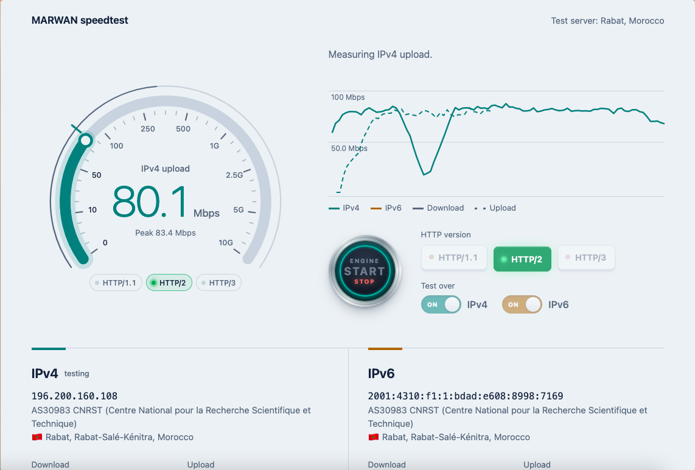
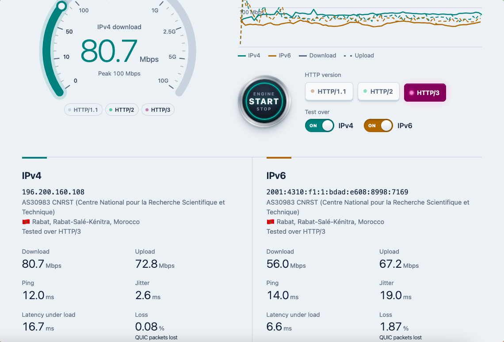

<p align="center">
  
</p>

# all-for-speed

A self-hosted browser speed test. It measures download, upload, ping, jitter, latency under load and
loss, separately over IPv4 and IPv6, and shows each address with its ASN, city and country. The tests can be carried over HTTP/1.1 or HTTP/2 or HTTP/3.

One Go binary serves the page, the test endpoints, TLS (HTTP/1.1 and HTTP/2 on TCP 443, HTTP/3 on UDP 443) and the ACME challenges for Let's Encrypt. The only dependency is quic-go for HTTP/3. 
The ASN, city and country are looked up locally (DB-IP Lite), never sent to a third party.

## Screenshots

| A test running over HTTP/2 | Results over HTTP/3, IPv4 and IPv6 |
|---|---|
|  |  |

## How dual-stack and protocol testing works

The page lets the visitor pick the HTTP version (HTTP/1.1 by default) and tests IPv4
and IPv6 separately. Each combination has its own hostname:

| Name | DNS | Serves |
|---|---|---|
| `speedtest.example.org` | A + AAAA | the page |
| `v4-h1.speedtest.example.org` | **A only** | IPv4 over HTTP/1.1 (six TCP connections) |
| `v6-h1.speedtest.example.org` | **AAAA only** | IPv6 over HTTP/1.1 |
| `v4-h2.speedtest.example.org` | **A only** | IPv4 over HTTP/2 |
| `v6-h2.speedtest.example.org` | **AAAA only** | IPv6 over HTTP/2 |
| `v4.speedtest.example.org` | **A only** | IPv4 over HTTP/3 |
| `v6.speedtest.example.org` | **AAAA only** | IPv6 over HTTP/3 |

The four `-h1` / `-h2` names can be CNAMEs:

```
v4-h1.speedtest  IN CNAME  v4.speedtest
v4-h2.speedtest  IN CNAME  v4.speedtest
v6-h1.speedtest  IN CNAME  v6.speedtest
v6-h2.speedtest  IN CNAME  v6.speedtest
```

How each protocol is pinned:

- **HTTP/1.1 names** offer only `http/1.1` in the TLS handshake, so the browser can't pick anything else.
- **HTTP/2 names** offer HTTP/2 and never advertise HTTP/3.
- **HTTP/3 names** send `Alt-Svc: h3=":443"`; the page sends a few light requests (up to 2.5 s) until the browser has moved to QUIC. If UDP is blocked, the browser stays on HTTP/2 and the page says so.
- Browsers reuse a connection for another hostname when the IP matches and the certificate on that connection covers the new name too. To stop that, each group of names gets its own certificate (see below). If it happens anyway, the server answers `421 Misdirected Request`; Chrome and Firefox then retry on a fresh connection, but Safari doesn't, which is why separate certificates matter.

When the page opens it checks every hostname in the background. A protocol whose names don't answer (for example, DNS not added yet) is greyed out. The choice is remembered in the browser; `?proto=h1`, `?proto=h2` or `?proto=h3` in the URL selects one directly, and `-default-proto` sets the server-wide default.

The three lights under the gauge show the version each request really used, as reported by the server in an `X-Proto` response header.

To let browsers start on HTTP/3 from the very first request, add HTTPS records (type 65) for the HTTP/3 names only:

```
v4.speedtest  IN HTTPS 1 . alpn="h3,h2" ipv4hint=<your IPv4>
v6.speedtest  IN HTTPS 1 . alpn="h3,h2" ipv6hint=<your IPv6>
```

### HTTP/3 tests for 10Gbps+ connections

QUIC runs in userspace on both ends, so one connection is limited by CPU, mostly in the browser. On a fast desktop expect HTTP/3 results of roughly 1–3 Gbps, where HTTP/1.1 over six TCP connections can reach 5–9 Gbps. Up to about 1 Gbps (most visitors) the protocol makes no visible difference. That's why HTTP/1.1 is the default; visitors can switch with the HTTP version keys, and the page explains why. `-h2=false` or `-h3=false` in `EXTRA_ARGS` removes a protocol from the page.

The server's QUIC receive buffers need `net.core.rmem_max` / `net.core.wmem_max` of at least 7.5 MB. Those limits are host-wide and can't be raised from inside an unprivileged container. On your hypervisor host, check net.core.rmem_max and net.core.wmem_max, and if under 7500000, do:

```bash
cat > /etc/sysctl.d/90-quic-buffers.conf <<'EOF2'
net.core.rmem_max = 7500000
net.core.wmem_max = 7500000
EOF2
sysctl --system
```

This only raises the cap a program may request; it changes no defaults.

## Install (Alma/Rocky Linux 10)

1. Create the DNS records above, all pointing at the container.
2. Copy this folder to the box and run, as root:

   ```bash
   DOMAIN=speedtest.example.org NAME="Example speed test" LOCATION="Rabat, Morocco" \
   EMAIL=noc@example.org bash deploy/install.sh
   ```

   This installs Go and certbot, opens TCP 80/443 and UDP 443, builds the binary, creates the `speedtest` user, downloads the GeoIP databases, starts the service, and gets the TLS certificates. Names without DNS records yet are left out with a warning; re-run the script after adding them. Without `EMAIL`, it stops before the certificate. 
   It ends with a list of checks and "Install complete" when everything is in place.

3. Open https://speedtest.example.org.

Settings live in `/etc/speedtest/speedtest.env`; after editing, run `systemctl restart speedtest`:

| Setting | Meaning |
|---|---|
| `DOMAIN` | main hostname (required) |
| `NAME` | site name in the page header, browser tab and home-screen icon (default "Speed test") |
| `LOCATION` | server location shown on the page, e.g. "Rabat, Morocco" (hidden when empty) |
| `MAX_DOWN` | download speed cap per visitor, e.g. `1G` or `500M` (default `0`, no limit) |
| `MAX_UP` | upload speed cap per visitor (default `0`, no limit) |
| `EXTRA_ARGS` | any other flags, e.g. `-default-proto h3` |

### Certificates

Four Let's Encrypt certificates, one per group of names, so a browser never reuses one protocol's connection for another's hostname:

| Certificate | Names |
|---|---|
| `speedtest` | the page name |
| `speedtest-h3` | `v4.` and `v6.` |
| `speedtest-h2` | `v4-h2.` and `v6-h2.` |
| `speedtest-h1` | `v4-h1.` and `v6-h1.` |

certbot keeps them in `/etc/letsencrypt/live/<name>/`; its deploy hook copies each to `/etc/speedtest/tls/<name>/`, where the server picks the right one for each hostname and reloads it after renewal. 

## Speed caps

`MAX_DOWN` and `MAX_UP` cap how fast one visitor (one IPv4 address or IPv6 /64) can download or upload, shared across that visitor's parallel connections. Suffixes are decimal bits per second: `500M`, `2.5G`, `800k`. The page tells visitors about the cap, and when both directions are capped, the dial's scale ends just above it. Uploads are slowed by reading them at the capped rate, which makes TCP or QUIC flow control hold the browser back.

## What runs

| Unit | Does |
|---|---|
| `speedtest.service` | the server, as user `speedtest`, sandboxed, on ports 80 and 443 |
| `speedtest-geoip.timer` | refreshes DB-IP Lite on the 3rd of each month |
| `certbot-renew.timer` | renews the certificate; the deploy hook copies it to `/etc/speedtest/tls` |
| `speedtest-fq.service` | puts the `fq` qdisc on the container's interface (better pacing at 10G) |

Both the certificate and the GeoIP files are picked up automatically when they change.
`systemctl reload speedtest` forces a GeoIP reload.

## Measurement notes

- **Download / upload:** 6 parallel requests for 10 s each: six TCP connections on HTTP/1.1, six streams on one connection with HTTP/2 or HTTP/3. The first 1.5 s are excluded to skip ramp-up. HTTP/2 and HTTP/3 get large flow-control windows (64 MB / 96 MB per connection) so uploads aren't capped by the defaults.
- **Upload pacing:** each upload request is sized to last about 1.5 s at the speed measured so far (±20% at random, up to 64 MiB), and the six streams start 120 ms apart. On HTTP/1.1 each stream keeps a second request lined up so its connection never waits for a reply.
- **Ping / jitter:** median of 20 small requests on a warm connection, using the browser's Resource Timing so JavaScript overhead isn't counted. Jitter is the mean difference between consecutive pings.
- **Latency under load:** the server's smoothed RTT for the connection (TCP or QUIC), sampled every 100 ms during the download. A large rise over idle ping means bufferbloat on the path.
- **Loss:** measured per connection during the download. On HTTP/3 it is QUIC's own count of packets declared lost over packets sent. On HTTP/1.1 and HTTP/2 it is TCP retransmitted segments over data segments sent (`TCP_INFO`). Browsers can't send raw UDP or ICMP, so this is the closest reading a web page can take. Ping timeouts are shown alongside.

## Limits and abuse protection

- 16 concurrent transfers per IPv4 address or IPv6 /64; 512 for the whole server.
- Downloads stop after 30 s; uploads are capped at 256 MiB per request.
- Static pages carry a strict Content-Security-Policy, HSTS, and no third-party requests.

## Sizing

TLS at 10 Gbps costs roughly one CPU core per direction with AES-NI, and QUIC costs more per byte than TCP. Give the container **4 vCPUs** or more so the server isn't the bottleneck when several visitors test at once.

## Icons

The mark is a teal throughput trace. To use another logo:

```bash
dnf install librsvg2-tools
tools/make-icons.sh /path/to/logo.svg '#f7f9fb'   # square SVG, background colour
bash deploy/install.sh                            # rebuild to embed the new icons
```

## Development

```bash
go build -o speedtest . && ./speedtest -dev -https "" -http "" -plain :8080 \
    -geo-city city.mmdb -geo-asn asn.mmdb
# open http://localhost:8080 — v4 tests go to 127.0.0.1, v6 to [::1] (HTTP/1.1 only)
```

To try HTTP/3 locally, run with `-https :8443` and a self-signed certificate. Chrome only uses QUIC with an untrusted certificate when its key is pinned:
`--ignore-certificate-errors-spki-list=<base64 SHA-256 of the SPKI>`.

`go test ./...` runs the GeoIP reader tests when `MMDB_TESTDATA` / `MMDB_EXPECTED` are set; `tools/gen_expected.py` builds the reference results with MaxMind's Python reader.

## License

Copyright (C) 2026 MARWAN.

This program is free software: you can redistribute it and/or modify it under the terms of the GNU General Public License as published by the Free Software Foundation, either version 3 of the License, or (at your option) any later version. It is distributed in the hope that it will be useful, but WITHOUT ANY WARRANTY; see [LICENSE](LICENSE).

Third-party parts keep their own licenses:

- [quic-go](https://github.com/quic-go/quic-go) (HTTP/3): MIT.
- IP geolocation by [DB-IP](https://db-ip.com): CC BY 4.0. The databases are downloaded at install time, and the attribution link in the page footer is required by their license.
